<!-- Generated by scripts/build-readme-svgs.mjs from scripts/products.json. Edit those and run `npm run build`. -->

<a href="https://www.idevtim.com"><picture><source media="(prefers-color-scheme: light)" srcset="assets/readme/hero-light.svg"></picture></a>

  <a href="https://www.idevtim.com"><picture><source media="(prefers-color-scheme: light)" srcset="assets/readme/btn-book-light.svg"></picture></a>
  <a href="https://x.com/idevtim"><picture><source media="(prefers-color-scheme: light)" srcset="assets/readme/btn-x-light.svg">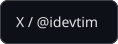</picture></a>
  <a href="https://linkedin.com/in/idevtim"><picture><source media="(prefers-color-scheme: light)" srcset="assets/readme/btn-linkedin-light.svg">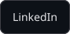</picture></a>

<picture><source media="(prefers-color-scheme: light)" srcset="assets/readme/h-featured-light.svg"></picture>

<a href="https://lunodb.app"><picture><source media="(prefers-color-scheme: light)" srcset="assets/readme/featured-lunodb-light.svg">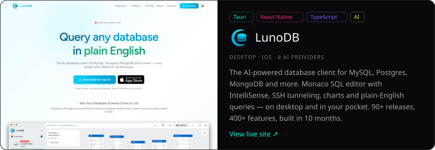</picture></a>

<a href="https://lastseenup.com"><picture><source media="(prefers-color-scheme: light)" srcset="assets/readme/featured-lastseenup-light.svg">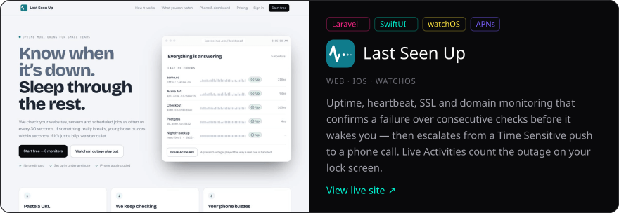</picture></a>

<a href="https://tryisleta.com"><picture><source media="(prefers-color-scheme: light)" srcset="assets/readme/featured-isleta-light.svg">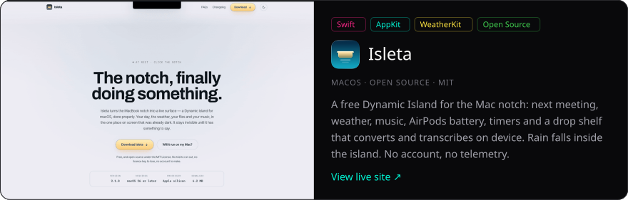</picture></a>

<picture><source media="(prefers-color-scheme: light)" srcset="assets/readme/h-everything-light.svg">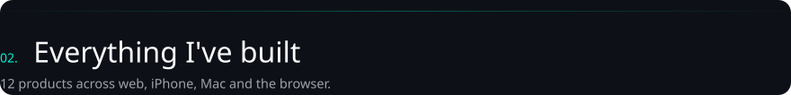</picture>

  <a href="https://lunodb.app"><picture><source media="(prefers-color-scheme: light)" srcset="assets/readme/card-lunodb-light.svg">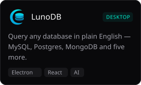</picture></a>
  <a href="https://lastseenup.com"><picture><source media="(prefers-color-scheme: light)" srcset="assets/readme/card-lastseenup-light.svg">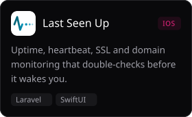</picture></a>
  <a href="https://tryisleta.com"><picture><source media="(prefers-color-scheme: light)" srcset="assets/readme/card-isleta-light.svg">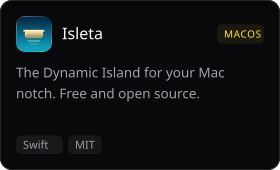</picture></a>

  <a href="https://itsworthmore.com"><picture><source media="(prefers-color-scheme: light)" srcset="assets/readme/card-itsworthmore-light.svg">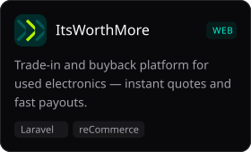</picture></a>
  <a href="https://listergenius.com"><picture><source media="(prefers-color-scheme: light)" srcset="assets/readme/card-listergenius-light.svg">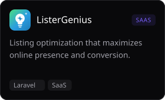</picture></a>
  <a href="https://apps.apple.com/us/app/feevio/id6759834831"><picture><source media="(prefers-color-scheme: light)" srcset="assets/readme/card-feevio-light.svg">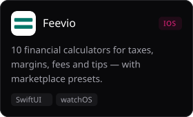</picture></a>

  <a href="https://idevtim.github.io/zenfulyouth/"><picture><source media="(prefers-color-scheme: light)" srcset="assets/readme/card-zenful-youth-light.svg">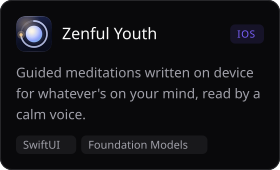</picture></a>
  <a href="https://apps.apple.com/us/app/cage-break-rescue-run/id6786849290"><picture><source media="(prefers-color-scheme: light)" srcset="assets/readme/card-cage-break-light.svg">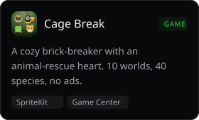</picture></a>
  <a href="https://apps.apple.com/us/app/piece-of-mind-picture-puzzles/id6792975520"><picture><source media="(prefers-color-scheme: light)" srcset="assets/readme/card-piece-of-mind-light.svg">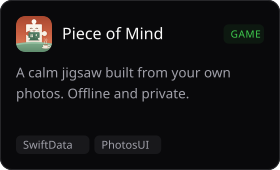</picture></a>

  <a href="https://lunopeak.com"><picture><source media="(prefers-color-scheme: light)" srcset="assets/readme/card-lunopeak-light.svg">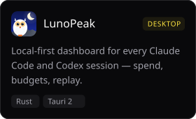</picture></a>
  <a href="https://github.com/idevtim/chillmac"><picture><source media="(prefers-color-scheme: light)" srcset="assets/readme/card-chillmac-light.svg">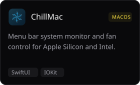</picture></a>
  <a href="https://chromewebstore.google.com/detail/demarkup/dmajejnedpjiecfnpmmemkgnkideecfg"><picture><source media="(prefers-color-scheme: light)" srcset="assets/readme/card-demarkup-light.svg">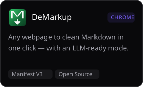</picture></a>

<picture><source media="(prefers-color-scheme: light)" srcset="assets/readme/h-about-light.svg">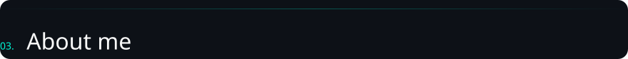</picture>

<picture><source media="(prefers-color-scheme: light)" srcset="assets/readme/about-light.svg">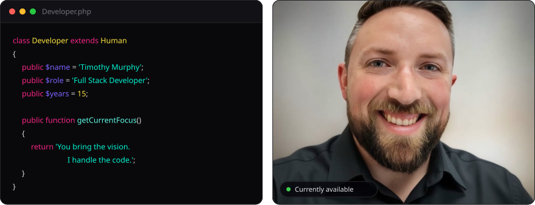</picture>

<picture><source media="(prefers-color-scheme: light)" srcset="assets/readme/stack-light.svg">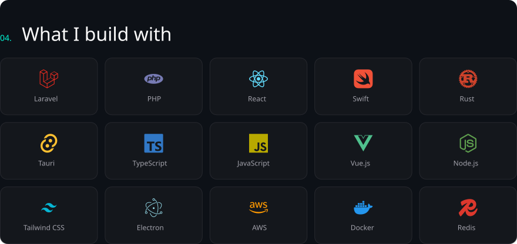</picture>

<picture><source media="(prefers-color-scheme: light)" srcset="https://streak-stats.demolab.com?user=idevtim&amp;hide_border=true&amp;background=FFFFFF&amp;stroke=E4E4E7&amp;ring=0F766E&amp;fire=BE185D&amp;currStreakNum=18181B&amp;sideNums=18181B&amp;currStreakLabel=0F766E&amp;sideLabels=52525B&amp;dates=71717A"></picture>

<a href="https://www.idevtim.com"><picture><source media="(prefers-color-scheme: light)" srcset="assets/readme/footer-light.svg">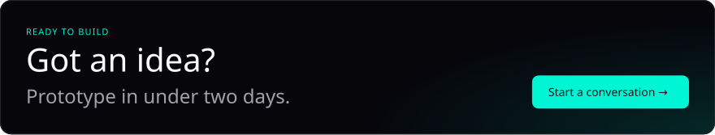</picture></a>
